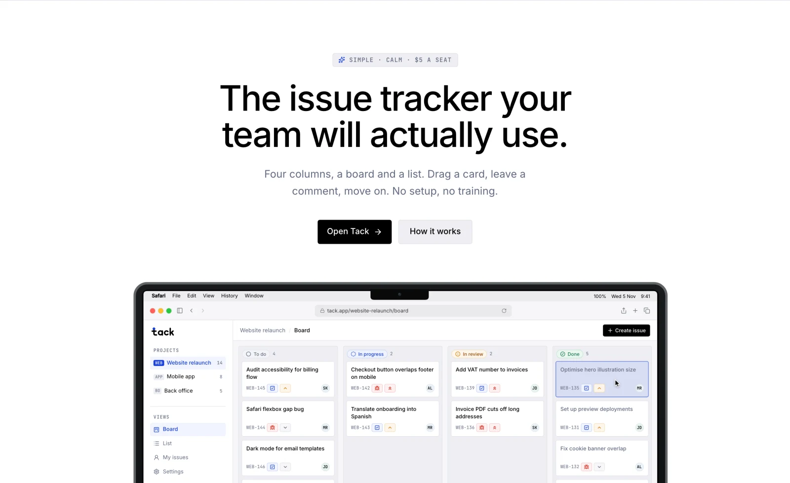
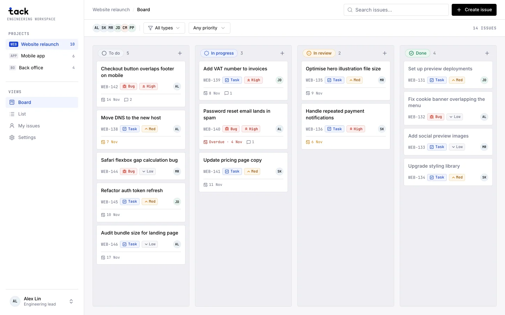
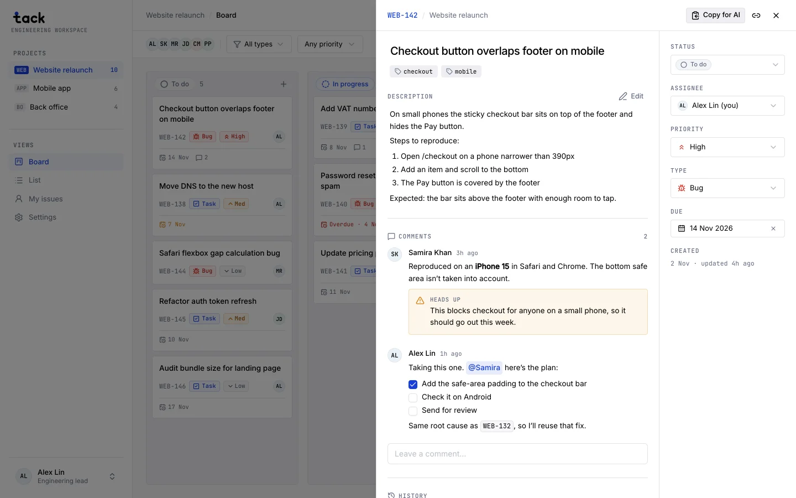
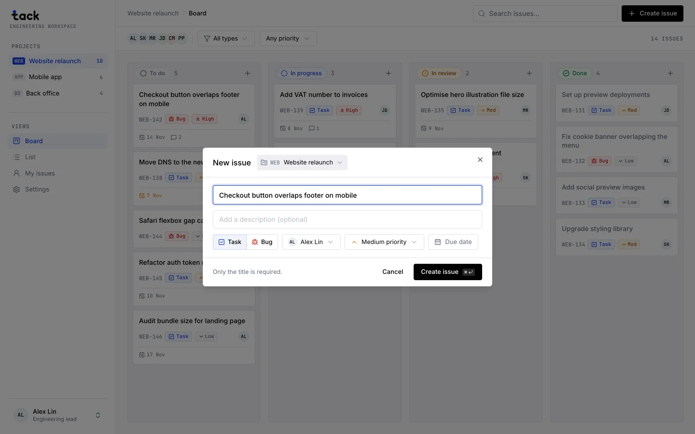
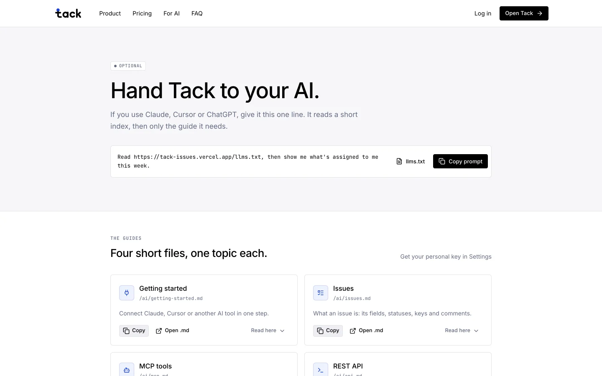
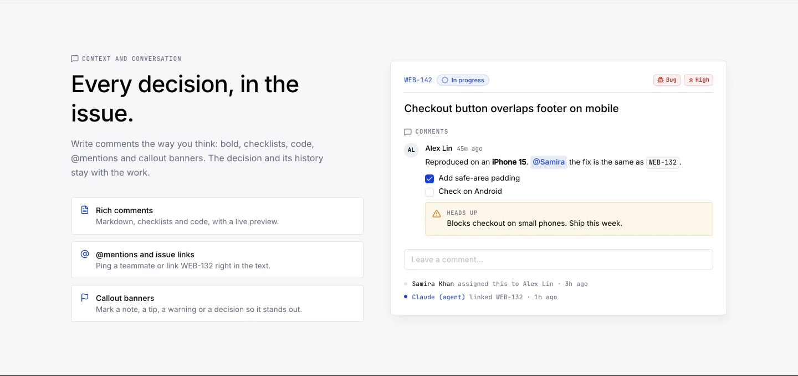
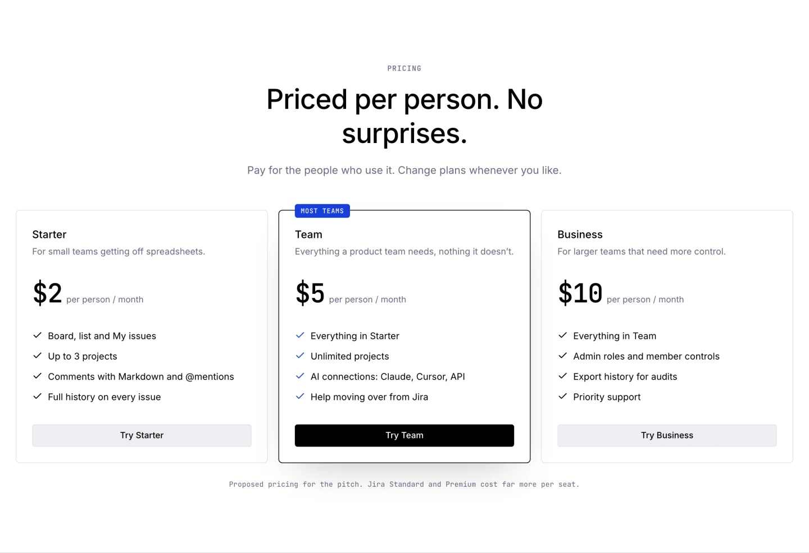
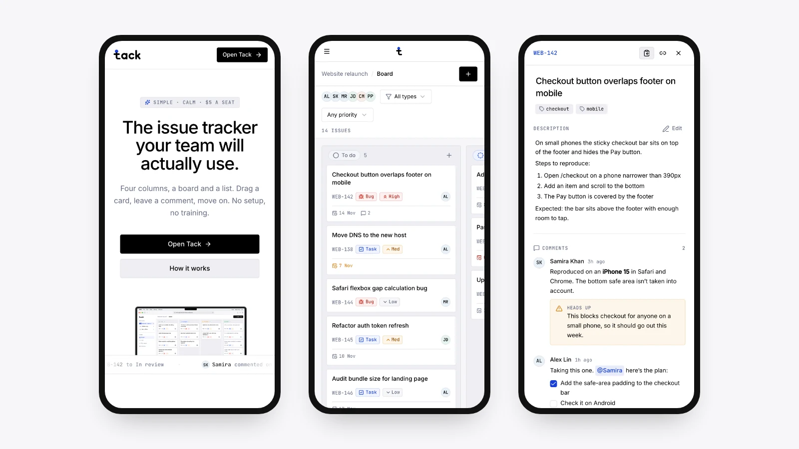
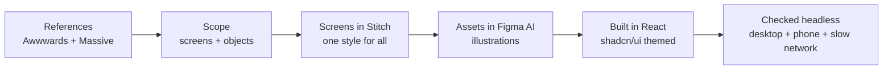
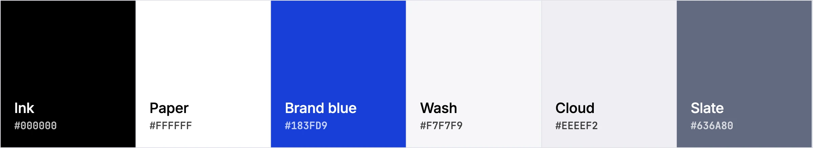

<p align="center">
  <a href="https://tack-issues.vercel.app"></a>
</p>

<h1 align="center">Tack</h1>

<p align="center">
  A calm, simple issue tracker: a board, a list and four columns. A design experiment, built website and web app together in about two days.
  <br><br>
  <a href="https://tack-issues.vercel.app"><b>Visit the website →</b></a>
  &nbsp;&nbsp;·&nbsp;&nbsp;
  <a href="https://tack-issues.vercel.app/app/WEB/board"><b>Open the app →</b></a>
</p>

<p align="center">
  
  
  
  
  
  
</p>

> [!NOTE]
> Everything runs on dummy data. Sign-in is a placeholder button, and any change you make stays in your own browser.

<br>

## The app

<table>
  <tr>
    <td width="50%"></td>
    <td width="50%"></td>
  </tr>
  <tr>
    <td width="50%"><b>Drag it, done.</b> Four columns, every card in view, type and priority readable at a glance.</td>
    <td width="50%"><b>Every decision in the issue.</b> Comments with checklists, callouts, @mentions and issue links.</td>
  </tr>
  <tr>
    <td width="50%"></td>
    <td width="50%"></td>
  </tr>
  <tr>
    <td width="50%"><b>New issue in five seconds.</b> Only the title is required.</td>
    <td width="50%"><b>Hand it to your AI, if you want.</b> A short <a href="https://tack-issues.vercel.app/llms.txt">llms.txt</a> index plus one guide per topic.</td>
  </tr>
</table>

## The website

<table>
  <tr>
    <td width="50%"></td>
    <td width="50%"></td>
  </tr>
</table>

<p align="center"></p>

<br>

## How it was designed



1. **Study, don't copy.** Took the feel from sites in the [Awwwards directory](https://www.awwwards.com/directory/), and from [Massive](https://massive.com/) the idea of a site your AI can read.
2. **Scope first.** Agreed the screens and the few objects (projects, issues, people) before drawing anything.
3. **Screens in Stitch.** Every screen was laid out in Google Stitch from one reference screen, so they share one look.
4. **Assets in Figma.** The illustrations came from Figma AI, then were animated frame by frame from those same drawings.
5. **Built for real.** React with shadcn/ui, themed so every menu, toast and dialog belongs to Tack.
6. **Checked like a release.** Every page on desktop and phone, every open menu, a slow-network test, and zero sideways scroll.

## Design principles

| | |
|---|---|
| **People first, AI optional** | Everything works with plain clicks. AI tools can connect, and every change they make is labelled. |
| **Simple yet elegant** | Four columns, one list, one place for your work. No setting that isn't needed. |
| **One style everywhere** | One focus ring, one tab style, one way menus look, on every screen. |
| **Motion that explains** | Cards glide when you drag them, the hero shows a real drag, nothing moves just to move. |
| **Readable at a glance** | Bugs, tasks and priorities each have their own colour and icon. |
| **Fast on bad networks** | A skeleton of the page in about a second, before the code has arrived. |

<p align="center"></p>

## Built with

| Part | Tools |
|---|---|
| Design | Google Stitch (screens), Figma AI (illustrations) |
| App | React 19, TypeScript 5.8, Vite 6, React Router 7 |
| UI | Tailwind CSS 4, shadcn/ui on Radix, Lucide icons, Sonner toasts |
| Interaction | dnd-kit (drag and drop), Motion 12 (animation), react-markdown + GFM (comments) |
| Type | Inter, JetBrains Mono |
| Hosting | Vercel, deploys on every push to `main` |

## Run it locally

```bash
npm install
npm run dev
```

Then open http://localhost:5173.

<br>

<p align="center"><sub>Designed and built by <a href="https://github.com/hexabytecode">Aditya Uphade</a>. Tack is a design study, not a live product.</sub></p>
